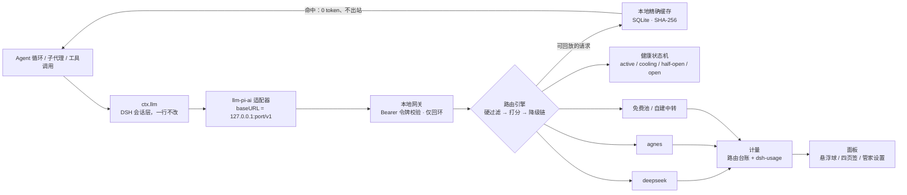

# DSH Token Steward（管家）

> **给 DeepSeek Harness 用的模型矩阵调度中枢：把任意 OpenAI 兼容上游接进同一张矩阵，按任务属性自动选路，失败自动换人，用量与成本一眼可见。**
>
> 官方 API、免费镜像、自建中转、贵但全能的顶配模型，都可以挂在同一张池子里。插件在 `127.0.0.1` 起一个 OpenAI 兼容网关，把 `llm-pi-ai` 的 `baseURL` 指过去就行——DSH 的会话、子代理、工具调用一行都不用改。选路、降级、健康熔断、精确缓存与计量全部发生在网关里。
>
> 矩阵、厂家密钥、每个型号的价目和擅长标签，都在 DSH 设置页的「管家设置」里维护；也可以直接让 Agent 用对话改——插件注册了 `token_steward_manage` 工具和同名技能。

**版本：** 1.1.1 | **适用：** DeepSeek Harness ≥ 0.2.1-rc.3 | **测试：** 488 条

> **如果它帮到了你，去仓库点一颗 Star 吧** —— 作者 **[@JiamingShi-JsPhys](https://github.com/JiamingShi-JsPhys)**。
> 一个 Star 不花什么力气，但对一个人维护的插件来说是继续修 bug、补厂商、跟进 DSH 新版本的直接动力。

---

## 安全与开源声明

> **免责声明**：本插件是个人为日常使用而写的调度工具，不是经过同行评审的服务。它在你的机器上真实地花你的钱：白嫖模式之外的每一次调用都会按上游账单计费。作者不对任何第三方模型服务的行为、价格变动、可用性，以及由此产生的费用负责。
>
> **密钥**：面板里粘贴的 API Key 以明文存放在 `$DSH_HOME/token-steward/vendors.json`（权限 0600，仅本机可读）。它不会进入日志、快照或任何过线 JSON，但**它不是加密存储**——和 DSH 自己的凭据文件同级对待。
>
> **素材**：厂商头像（`assets/avatars/`）取自 B 站 UP 主 **@zipzippipe** 的立绘作品，仅做 256×256 脸部裁切用于界面展示，版权归原作者所有。`assets/avatars/full/` 保留原图以便追溯。

---

## 为什么需要 Token 管家？

DSH 的 `llm-pi-ai` 适配器在构造 SDK 客户端时就捕获了 `fetch`，且交给它的请求体是深冻结的。这意味着**插件无法可靠地改写「这次用哪个模型」**，更无法在上游 429 时换一个模型重发。任何试图在 `llm/stream` 瀑布里做手脚的方案，都会在 DSH 升级的那天失效。

Token 管家换了一条路：既然插件改不了请求体，那就在 HTTP 这一层接管整个请求。网关收下 OpenAI 形状的请求，自己决定发给谁、失败了换谁、要不要读缓存，然后把结果原样转回去。上游看到的是一次普通调用，DSH 看到的是一次普通响应。

由此得到三件 DSH 本身给不了的东西：

- **按任务选路**：写代码、长文推理、看图、并发轰炸——不同请求落到不同型号，而不是全局钉死一个。
- **自动容灾**：429 冷却、5xx 熔断、401 直接下线、上下文超限换大窗口，都在一次客户端请求内完成，会话不中断。
- **真实的账**：每一次调用的 token 与费用都记在路由维度上，缓存命中和降配选路省下的钱单独记账。

---

## 架构与流水线

网关是微内核：**硬过滤 → 打分 → 降级链**。硬过滤先淘汰不合格的型号（缺能力标签、窗口放不下、被用户下线、非对话模型），打分器再在剩下的里排序，首个失败时按序顶上。



图里刻意说明的四件事：

- **网关只绑 `127.0.0.1`**，端口由系统分配；每次启动生成随机本地令牌，客户端必须带 `Authorization: Bearer`。
- **硬过滤是硬拒绝，不是降权。** 写代码的请求不会被派给看不懂代码的模型，哪怕它便宜十倍。
- **降级只在「客户端还没收到第一个字节」时发生。** 首字节一旦放出，重发就是第二份副作用，网关宁可报错。
- **缓存命中不经过健康状态机。** 本地回放不给模型制造假样本，也不影响它的延迟 EWMA。

---

## 四种调度模式

| 模式 | 虚拟 id | 主序 | 破平 |
|---|---|---|---|
| **极致便宜** | `steward:frugal` | 通过硬过滤的 **C/D 级**里最便宜 | 同价比六维分 |
| **效率优先** | `steward:balanced` | 任务对应维度必须 **A / A+ 及以上**，再按质量 0.6 + 成本 0.4 | **同批并发打散** → 在飞请求数 |
| **最强火力** | `steward:max_power` | **六维总和**最高（不是单项） | Tier → 上下文窗口 |
| **白嫖** | `steward:free` | 只用**价目为 0** 的型号 | 当前需求维度的质量分 |

效率模式的打散是决定性的：同一批（比如 4 个代理同时开工）里已被派过的模型会被压到后面，于是 4 个请求自然落到 4 个不同上游，不会一起撞 429。

**白嫖模式是一等模式，不是「省钱」的别名。** 它做的是硬过滤：价目为 0 的型号才进候选——免费池里标 0 的，或者你自己在「管家设置」里填成 0 的。一个都选不到时，它报错并告诉你原因（`agnes/agnes-3.0-flash: not-free`），**绝不会偷偷切到付费模型**。自定义厂家里没有目录价目的型号，会以「推定免费」的身份进入候选，成本看板仍如实标为未定价，不编数字。

模式跟着输入框里选的模型走：选「管家·自动」就用当前全局档位，选「管家·白嫖」就钉死免费档。面板上切档位，等价于切「管家·自动」的行为。`steward:subagent` 是**档位不是模式**：它不改全局档位，只改变「这一个请求」的打分规则——见下一节。

---

## 子代理：把哪个模型派出去

DSH 的子代理（`dsh-tool-subagent`）默认继承父会话的路由。这在「主代理用最强火力、子代理只做搜索」时浪费钱，在「主代理用便宜档、子代理要改关键代码」时又拖后腿。1.1.0 给子代理单开了一个档位：

```yaml
- id: subagent
  name: '@deepseek-ai/dsh-tool-subagent'
  config:
    agentOptions:
      provider: steward
      model: steward:subagent
```

`steward:subagent` 不走三个调度模式，它有自己的打分：

| 因素 | 权重 | 理由 |
|---|---|---|
| agentic 维度质量 | 0.6 | 子代理接的是读文件、跑命令、改代码、验证的真活 |
| 成本 | 0.4 | 一个搜索型子任务用顶配模型是纯浪费 |
| 上下文窗口 | 每 100k +4 分，封顶 40 | 子代理带着父会话的已完成轮次，长前缀是常态 |
| 延迟 | 最多 +20 分 | 子代理在关键路径上，快一点更好 |
| 并发打散 | 决定性（每个 burst −20000） | 一批子代理同时开工时落到不同上游，不一起撞 429 |
| 会话粘性 | +300 | 同一子代理会话的后续轮次沿用同一模型，保住前缀缓存 |

硬门槛是 agentic 维度 **B+**：弱模型会把工具调用写坏、把半截结果当完成。白嫖模式下子代理同样只跑零成本模型——这个承诺不会被档位绕过。

想让 Agent 在派活前先问一句「该用谁」，工具里有 `recommend_model`：

```
action=recommend_model, profile=subagent, task="读仓库并改一个测试"
```

它返回按上述规则排好序的 `provider/model` 与逐项理由（`PROFILE:subagent` `GATE:B+` `BURST:0` `WINDOW:128000` …）。`/v1/models` 也会把 `steward:subagent` 连同擅长说明一起发布，模型发现与选择界面据此就能给出人话解释。

---

## 换模型时，上下文怎么办

先说结论：**消息日志本身不会丢**——DSH 的会话层把完整历史原样发给新模型，语义上下文是连续的。真正会损失的是三样东西，1.1.0 各有一条对策：

1. **上游前缀缓存（KV 复用）**。每换一次模型，新厂商要从零读完整段前缀，长会话的输入费用会翻几倍。对策是**会话粘性**：同一会话（`session_id` / agent id）里一旦某个模型成功服务过，下一轮给它一个小额加分（frugal +60 / balanced +300 / max_power +120）。加分只在你追我赶的候选之间生效，不推翻模式主序，也远小于并发打散的罚分；主会话与子代理按档位分开记，互不串味。
2. **上一家的私有字段**。DeepSeek / Moonshot 在助手消息上回写 `reasoning_content`，OpenRouter 回 `reasoning_details`，Anthropic 形状的中转站用 `thinking` 块与 `cache_control` 标记。同一家自己认得，换一家严格些的上游会 400，或者把上一家的思考过程当正文喂进去。对策是**跨厂商请求归一化**：只在目标厂商 ≠ 上一轮服务的厂商时，剥掉这些字段（系统提示与用户内容一字不动）。
3. **窗口收缩**。会话长过新模型的窗口时，硬过滤会直接拒绝并说明原因（`window-too-small`），而不是悄悄截断历史——上下文可以少用，不能被删。

至于「把上一家的 KV 状态直接搬给下一家」：这需要模型内部状态，公开的 `chat/completions` 协议给不了。相关研究（跨模型 KV 缓存迁移）都要求权重与推理栈可控，插件这一层做不到，也不假装做到。上面三条是 API 层能拿到的全部收益。

---

## 容灾

| 上游状况 | 行为 |
|---|---|
| 429 | 指数退避冷却（上限 16 倍），本次立刻换下一个候选 |
| 连续超时 / 5xx / 传输失败 | 达到阈值熔断，到期半开试探，成功才彻底复位 |
| 401 / 403 | 一次即熔断（凭据坏了重试无意义） |
| 400 含上下文措辞 | 归类为「上下文超限」，换更大的窗口 |
| `max_tokens` 超上游上限 | 出站前按窗口压到 65536 |
| 首字节已发出后失败 | **不可降级**——重发会产生第二份副作用 |
| 全部候选失败 | 502 + 可读原因，不抛未捕获异常 |

窗口过滤只看**输入**：估算输入加 256 token 的余量必须放得下。期望输出不再参与过滤，而是在出站前按「窗口 − 估算输入」压低 `max_tokens`——之前用输入加输出做过滤，会让一个 128k 窗口的模型在 132k 的请求上被误判出局。

---

## SQLite 本地精确缓存

`routing.cache.exact_match: true` 时，对 prompt 取 SHA-256，在 `$DSH_HOME/token-steward/cache.sqlite` 里查上次响应；命中直接回放字节——**0 token**、不出站、不计费。缓存跨重启保留；没有 `node:sqlite` 的老宿主自动降级为内存 LRU，行为一致。

缓存键覆盖 prompt 定义性字段、虚拟 id、生效模式与流式形状，因此换模式、换流式形状天然失效。三条硬规则：**带 tools 的请求绝不缓存、超长 prompt 绝不缓存、模型被下线后其缓存条目作废。**

---

## 计量

token 的唯一真相源是 `dsh-usage` 的按日台账；本插件另记一条**路由维度**台账（谁被选中、降级几次、每模型延迟）。三条严谨性规则：

1. **未定价 ≠ 免费**：没有价目的模型，成本显示 `—`，面板还会提示「N 个模型未定价」。唯一例外是白嫖语义下的「推定免费」，它只影响选路，不影响记账。
2. **混币不相加**：CNY 与 USD 同时存在时总额显示 `—`，不把 1.5 元和 2.5 美元加成 4。
3. **计量不可用就说不**：没装 `dsh-usage` 时该区块显示「计量不可用」，不是 0。

价格表内置于 `src/core/pricing.ts`，按每百万 token 记榜单估算价，可在面板逐型号覆盖。查价时对 id 做归一化（大小写、点号↔连字符），因为上游常把 `agnes-3.0-flash` 写成目录里的 `agnes-3-0-flash`。

---

## 安装

### 1. 让 profile 依赖本包

```bash
cd ~/.dsh/profiles/desktop && pnpm add dsh-token-steward
```

### 2. 把插件插进插件名册

在 `~/.dsh/profiles/desktop/cordis.patch.yml` 追加（完整样例见包内 `cordis.patch.yml`）：

```yaml
- insert:
    - id: token-steward
      name: dsh-token-steward
      config:
        enabled: true
```

### 3. 把 `llm-pi-ai` 指向网关

```yaml
- id: llm-pi-ai
  name: '@deepseek-ai/dsh-llm-pi-ai'
  config:
    providers:
      steward:
        displayName: Steward Matrix
        api: openai-completions
        baseURL: http://127.0.0.1:51741/v1
        apiKeyEnv: STEWARD_LOCAL_TOKEN
        defaultMaxTokens: 65536
        models:
          - { id: 'steward:auto',      name: '管家·自动' }
          - { id: 'steward:frugal',    name: '管家·极致便宜' }
          - { id: 'steward:balanced',  name: '管家·效率优先' }
          - { id: 'steward:max_power', name: '管家·最强火力' }
          - { id: 'steward:free',      name: '管家·白嫖' }
          - { id: 'steward:subagent',  name: '管家·子代理' }
```

改完 profile 需要**重启 DSH 服务**才生效。

### 三个踩过的坑，务必照抄

- **`defaultMaxTokens: 65536`**。`llm-pi-ai` 的默认值是 128000，会原样写进请求的 `max_tokens`。Agnes 这类上游硬上限是 65536，直接回 400 `max_tokens 不能超过 65536`，会话当场失败。网关侧还会再按窗口压一次，但 profile 里的初值先写对能省掉一整类报错。
- **`STEWARD_LOCAL_TOKEN` 必须和网关一致。** 插件的 `apiKeyEnv` 指向进程环境里的本地令牌，而 DSH 可能在插件挂载之前就把它读进凭据缓存。系统用户环境变量里如果还留着旧令牌（换过 `gateway.json`、装过旧版本），每个请求都会被网关 401，界面显示「API 密钥无效 AUTH」。1.1.1 起网关**优先采用继承来的合法令牌**，主动对齐到 DSH 手里那把钥匙——两边不会再漂移；面板「管家设置 → 刷新」里能看到当前实际生效的令牌。
- **`apiKeyEnv: STEWARD_LOCAL_TOKEN`，不要写 `apiKey`**。`llm-pi-ai` 的 provider schema **没有 `apiKey` 字段**——写了会被静默忽略——凭据只通过 `apiKeyEnv` 从 `~/.dsh/.credentials.yaml` 的 `refs:` 解析。插件在网关启动时自己把本地令牌写进 `process.env.STEWARD_LOCAL_TOKEN`，所以两边名字必须一致，否则报 `No API key for provider: steward`。

端口默认 51741，可用 `gatewayPort` 配置改成 `0`（系统分配）或固定值；实际地址与令牌随时可以在「管家设置」里一键复制。

---

## 快速上手

**打开面板。** 右下角悬浮球环的颜色是当前模式，角标是**今日已省**（缓存命中 + 降配选路）。点开是四页签：成本看板、模型矩阵、路由日志、代理协作。

**接一家厂商（管家设置 → 厂家设置）。** 内置 21 家厂商目录（Anthropic、OpenAI、Google、DeepSeek、豆包、千帆、硅基流动、OpenRouter、opencode、Agnes、Moonshot、通义、智谱、MiniMax、xAI、Mistral、腾讯、阶跃……），每家都有官方地址与官网入口；也可以加自定义厂家，填自己的中转站地址。

- **拉取模型**：向 `/v1/models` 探一次真实清单，勾选要用的型号。
- **从系统导入这一家**：只把 DSH profile 里**地址对得上的那一家**搬进来（按规范化 URL 或厂商 id 匹配），不会一按就把所有厂商全拉进来。
- **同步到系统模型**：反向写回 DSH 的 provider 配置，保留注释与 `apiKeyEnv`，并补上 `defaultMaxTokens: 65536`。
- **删除**：显式删掉一家，保存永远不会顺手删东西。

**让白嫖可用。** 在「免费池」里挑一家（百度千帆 / 硅基流动 / OpenRouter）拉取并勾选，或者在任意厂家把型号价目填 0。启用的零成本卡片会挂「免费·白嫖可用」徽标，切到「管家·白嫖」立刻只剩它们。

**让 Agent 帮你改。** 直接说「把 xxx 接进来，只开三个模型，切到白嫖」，Agent 会调用 `token_steward_manage`（`show_status / recommend_model / add_or_update_vendor / set_enabled_models / tag_model / remove_vendor / set_mode`），改动走与面板完全相同的原子保存路径，立即热重载。派子代理前想先问「谁合适」，就让它调 `recommend_model`，拿到带理由的排序再决定。

---

## 虚拟模型 id

| id | 含义 |
|---|---|
| `steward:auto` | 按当前全局模式选路 |
| `steward:frugal` / `steward:balanced` / `steward:max_power` / `steward:free` | 钉死某个模式 |
| `steward:subagent` | 子代理档位：按 agentic 质量 + 成本 + 窗口 + 并发分散选型，不改全局模式 |
| `steward:pin/<provider>/<model>` | 直通某个具体模型（仍走熔断与计量） |
| `steward:alias/<name>` | `routing.aliases` 里定义的自定义意图 |

也可以直接写矩阵里某个真实模型 id，网关会直通到它。输入框的模型菜单里另有中文别名：管家·自动 / 管家·极致便宜 / 管家·效率优先 / 管家·最强火力 / 管家·白嫖 / 管家·子代理。

---

## 安全边界

- 网关**只绑 127.0.0.1**，端口由系统分配；
- 每次启动生成随机本地令牌，客户端必须带 `Authorization: Bearer <token>`；
- 令牌写进 `gateway.json`（0600），与模型配置同目录；
- 矩阵侧的凭据支持 `env:` / `file:` / `literal:` 引用，展开后的明文**只在内存**，不进日志、不进快照、不进任何过线 JSON；
- **所有面板 API 拒绝非回环请求**——这些端点会暴露本地令牌与全部模型清单；
- 中国区防封：Anthropic 的 API Key 输入框正上方有固定红字警告。

---

## 配置

| 键 | 默认 | 说明 |
|---|---|---|
| `enabled` | `true` | 关闭则完全不挂载：网关不起、面板不出现、路由不注册 |
| `poolPath` | `$DSH_HOME/token-steward/model_pool.yaml` | 矩阵配置路径（无 `vendors.json` 时的回退来源） |
| `gatewayPort` | `51741` | 网关端口，`0` = 系统分配 |
| `retainDays` | `180` | 路由台账保留天数 |
| `usagePollMs` | `15000` | 读 dsh-usage 台账的间隔（最小 2000） |

---

## 仓库布局

```
cordis.patch.yml   插件名册补丁（一行同时挂载 Host 与 Client 半区）
lib/index.js       Host 半区（ESM），由 loader 行直接加载
lib/client.js      Client 半区，window.__ModuleLoader__ 工厂形态，CSS 内联注入
src/core/          纯决策：类型、目录与价格、意图推断、路由、打分器、健康状态机
src/host/          宿主面：网关、上游转发、厂家存储、系统导入/同步、SQLite 缓存、面板路由
src/client/        面板：悬浮球、四页签、管家设置、头像与样式
assets/avatars/    厂商头像（256×256 脸部裁切）+ full/ 原图
tests/             node:test 断言，零外部服务
docs/              架构与决策记录
model_pool.example.yaml  矩阵配置样例
```

---

## 测试

```bash
npm install
npm run build      # 产出 lib/index.js 与 lib/client.js
npm test           # 先构建，再跑全部 488 条断言
npm run typecheck  # tsc --noEmit（strict + exactOptionalPropertyTypes + noUncheckedIndexedAccess）
```

测试全部是纯函数与本地回环，不访问外网、不花钱。网关回路、降级链、熔断状态机、缓存、价格归一化、系统导入作用域、面板路由的回环守卫都有覆盖。

---

## 已知局限

- **只支持 OpenAI 兼容的 `chat/completions`。** Anthropic 原生协议、Gemini 原生协议要经中转站转成 OpenAI 形状才能接入。
- **首字节之后的失败不重试。** 这是正确性优先的取舍：流式响应已经发出，重发会制造第二份副作用。
- **缓存只服务可复现的调用。** 带 tools、带随机种子、超长 prompt 都不缓存。
- **成本是台账与估算的合成。** 上游不返 usage 的调用只能记估算值；面板会标出来。
- **`vendors.json` 里的密钥是明文。** 权限 0600、只在本机，但不是加密存储。
- **跨模型不搬 KV 状态。** 公开协议下只能保住消息日志、清理上一家的私有字段、并用会话粘性少丢前缀缓存；模型内部状态无法迁移。窗口放不下时是拒绝，不是截断。
- **会话粘性只在本进程内。** DSH 重启后第一次请求会重新选路，之后照常粘住。

---

## 报告问题与反馈

仓库：<https://github.com/JiamingShi-JsPhys/dsh-token-steward>

提 issue 时请附上：DSH 版本、`gateway.json` 里的端口（**不要贴令牌**）、复现用的虚拟模型 id，以及面板「路由日志」里对应的那条记录。

---

## 开源许可与致谢

MIT，见 `LICENSE`。版本历史见 `CHANGELOG.md`，架构与决策记录见 `docs/architecture.md`。

觉得好用的话，顺手给 **[@JiamingShi-JsPhys](https://github.com/JiamingShi-JsPhys)** 的仓库点颗 Star：
<https://github.com/JiamingShi-JsPhys/dsh-token-steward>

- 厂商头像立绘：B 站 UP 主 **@zipzippipe**，版权归原作者所有。
- 面板与调度器的形态参考了 DSH 社区插件（`dsh-usage`、`dsh-provider-proxy`）的公开实现与文档。
