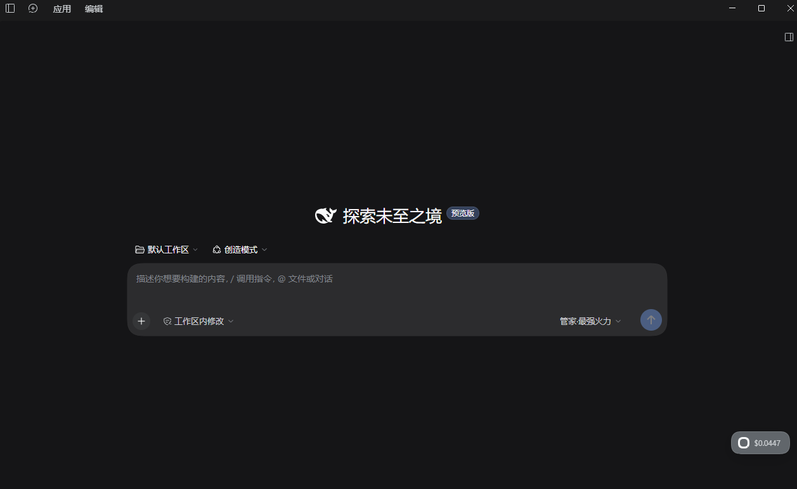
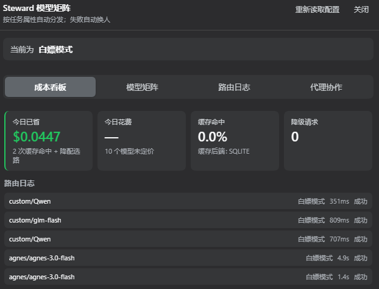
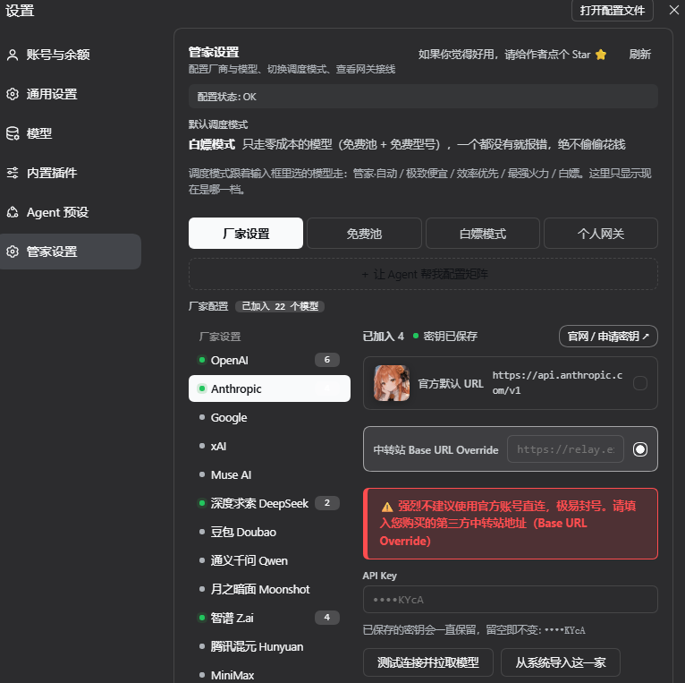
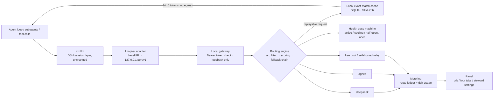

# DSH Token Steward

**A model-matrix orchestrator for DeepSeek Harness: pool any OpenAI-compatible upstream into one matrix, route each request by task profile, fail over automatically, and see usage and cost at a glance.**

Official APIs, free mirrors, self-hosted relays and expensive but capable flagship models can all sit in the same pool. The plugin starts an OpenAI-compatible gateway on `127.0.0.1`; you point `llm-pi-ai`'s `baseURL` at it and nothing else changes — DSH's sessions, subagents and tool calls stay as they are. Routing, failover, health breakers, the exact-match cache and metering all happen inside the gateway. Vendors, keys, per-model prices and capability tags are edited in DSH's settings page ("Steward settings"), or by asking the agent in conversation.

**English** · [简体中文](README.md)

**Version:** 1.2.2 ｜ **Works with:** DeepSeek Harness ≥ 0.2.1-rc.3 ｜ **Tests:** 594 ｜ **License:** MIT

> API keys pasted into the panel are stored encrypted, the master key lives in the system credential store, and neither reaches logs, snapshots or any JSON on the wire. Every panel route passes the host's connection admission before it runs. The threat model and its limits are in [Security boundary](#security-boundary) and [SECURITY.md](SECURITY.md).

<p align="center">
  
</p>

<p align="center">
  
  
</p>

*What it looks like inside DSH: an orb in the bottom-right corner with the current mode and "saved today" (top); opening it shows four tabs whose header says only which mode is active (bottom left); vendors, keys, prices and capability tags are maintained in DSH's "Steward settings" page (bottom right).*

---

## Contents

**Start**

- [Why a token steward?](#why-a-token-steward)
- [Install](#install)
- [Quick start](#quick-start)

**Going deeper**

- [Architecture and pipeline](#architecture-and-pipeline)
- [Four routing modes](#four-routing-modes)
- [Subagents: which model goes out](#subagents-which-model-goes-out)
- [When the model changes, what happens to the context](#when-the-model-changes-what-happens-to-the-context)
- [Failure handling](#failure-handling)
- [Local exact-match cache](#local-exact-match-cache)
- [Metering](#metering)
- [Virtual model ids](#virtual-model-ids)
- [Upstream protocols](#upstream-protocols-openai-compatible-and-anthropic-messages)
- [Configuration](#configuration)
- [Repository layout](#repository-layout)

**Other**

- [Security boundary](#security-boundary)
- [Tests](#tests)
- [Known limitations](#known-limitations)
- [Security and open-source notice](#security-and-open-source-notice)
- [Issues and feedback](#issues-and-feedback)
- [License and acknowledgements](#license-and-acknowledgements)

---

## Why a token steward?

DSH's `llm-pi-ai` adapter captures `fetch` when it builds the SDK client, and the request body it hands over is deeply frozen. That means **a plugin cannot reliably rewrite "which model this call uses"**, still less resend it to a different model when the upstream answers 429. Anything that fiddles with the `llm/stream` waterfall breaks the day DSH is upgraded.

This plugin takes another route: if the request body cannot be changed, take over the whole request one layer down. The gateway accepts an OpenAI-shaped request, decides who serves it, who takes over on failure, and whether the cache can answer, then passes the result back untouched. The upstream sees an ordinary call; DSH sees an ordinary response.

That buys three things DSH does not provide by itself:

- **Routing by task**: code, long-form reasoning, image input, bursts of concurrency — different requests land on different models instead of one global choice.
- **Automatic failover**: 429 cooling, 5xx breakers, 401 delisting and context-overflow re-routing all happen inside one client request, without breaking the session.
- **A real bill**: every call's tokens and cost are recorded per route, and the money saved by cache hits and cheaper routing is booked separately.

---

## Install

> **This package is not on npm yet** (`pnpm add dsh-token-steward` returns 404). Install from
> GitHub, one of two ways:
>
> - **With git**: `pnpm add https://github.com/JiamingShi-JsPhys/dsh-token-steward.git#v1.2.2`
>   (or `git clone` and then `pnpm add file:<local path>`)
> - **Without git**: download `dsh-token-steward-<version>.zip` from
>   [Releases](https://github.com/JiamingShi-JsPhys/dsh-token-steward/releases) (it ships a
>   prebuilt `lib/`, no compilation), unzip it, then `pnpm add file:<unzipped path>`

### 1. Make the profile depend on this package

Install the package into the profile you want it in (either command at the top of this section works; `dsh plugin` forwards its arguments to pnpm and installs into `~/.dsh/profiles/<name>/`):

```bash
dsh plugin --profile desktop add https://github.com/JiamingShi-JsPhys/dsh-token-steward.git#v1.2.2
```

Without git, use `dsh plugin --profile desktop add file:<unzipped path>` instead.

### 2. Add the plugin to the plugin roster

Append to `~/.dsh/profiles/desktop/cordis.patch.yml` (a complete example ships in `cordis.patch.yml`):

```yaml
- insert:
    - id: token-steward
      name: dsh-token-steward
      config:
        enabled: true
```

### 3. Restart DSH — the wiring is automatic

**You do not write this configuration by hand.** Once DSH is up and the gateway is ready, the plugin checks the `providers` of `@deepseek-ai/dsh-llm-pi-ai` in your profile and adds the missing `steward` entry:

```yaml
      steward:
        displayName: 管家
        api: openai-completions
        baseURL: http://127.0.0.1:51741/v1
        apiKeyEnv: STEWARD_LOCAL_TOKEN
        defaultMaxTokens: 65536
        models:
          - { id: 'steward:frugal',    name: '管家·极致便宜' }
          - { id: 'steward:balanced',  name: '管家·效率优先' }
          - { id: 'steward:max_power', name: '管家·最强火力' }
          - { id: 'steward:free',      name: '管家·免费档' }
```

The write-back is **textual**: it inserts or replaces only that `steward` block. Your comments, blank lines, indentation style and other vendors are not touched, and when the wiring is already correct not a byte is written. If the structure cannot be recognised (for example `providers: {...}` in flow style) it does nothing but log a line — it will not reshuffle your profile into something that fails to parse.

**Restart DSH once more** after that and the four modes appear in the model picker. A line in "Steward settings → personal gateway" tells you whether the wiring is in place.

> Prefer it not to touch your profile? Set `autoWire: false` in the plugin config and wire it
> yourself with the YAML above — the result is identical.

The picker shows only those four modes. The subagent-only model (`steward:subagent`) still works; it simply does not appear in the model picker, because it is for `dsh-tool-subagent`, not a mode a person picks (if you wire it by hand, set that `agentOptions` entry's `provider` to `steward` and `model` to `steward:subagent`).

### Four pitfalls, copy them exactly

- **`defaultMaxTokens: 65536`**. `llm-pi-ai` defaults to 128000 and writes that straight into the request's `max_tokens`. Upstreams such as Agnes cap it at 65536 and answer 400 `max_tokens 不能超过 65536`, killing the session on the spot. The gateway clamps again by window size, but getting the profile value right removes a whole class of errors.
- **`STEWARD_LOCAL_TOKEN` must match the gateway.** The plugin's `apiKeyEnv` names the local token in the process environment, while DSH's credential layer reads a snapshot taken at startup — it cannot see a `process.env` write made later by a plugin. Since 1.1.1 the plugin pushes the token through the host's `credentials.set` into the credential store, so the settings page shows "leave empty to use the stored credential" rather than "no environment variable detected". If a stale token is still sitting in the system user environment (after changing `gateway.json`, or after installing an older version), every request is answered 401 by the gateway and the UI shows "API key invalid AUTH". Since 1.1.0 there are three safeguards: ① the gateway **prefers an inherited valid token** and aligns itself with the key DSH holds; ② at startup, if the persisted token and the inherited one disagree, **both are accepted during the drift window** (the next start converges to one); ③ early versions also wrote the token back into the Windows user environment — since 1.2.0 that is off by default (`syncTokenEnv`), because it makes every process started afterwards inherit the token. ①② are enough to avoid drift. "Steward settings → refresh" shows the token actually in effect.
- **`apiKeyEnv: STEWARD_LOCAL_TOKEN`, never `apiKey`**. `llm-pi-ai`'s provider schema **has no `apiKey` field** — writing one is silently ignored — credentials are resolved only through `apiKeyEnv` from `refs:` in `~/.dsh/.credentials.yaml`. The plugin writes the local token into `process.env.STEWARD_LOCAL_TOKEN` when the gateway starts, so the two names must agree, or you get `No API key for provider: steward`.
- **When DSH will not open and reports "app failed to start / desktop welcome: Web authentication failed", clear the web session cookies first.** This has nothing to do with the plugin, keys or your account: the desktop host issues a `dsh-auth-<random>` cookie with a **new name** on every start and never retires the previous one; at around 70 of them the Cookie header crosses Node's 16 KB default, the host answers **431** to every credentialed request, and the desktop app, never seeing a 2xx, declares authentication failed. Since 1.1.0 the panel watches the count (amber at ≥ 40, red at ≥ 55): **quit DSH completely** (tray included), run `npm run repair:cookies`, and open it again — the script backs up the cookie database first and deletes only this machine's `127.0.0.1` `dsh-auth-*` entries.

The port defaults to 51741; set `gatewayPort` to `0` (system-assigned) or to a fixed value. The actual address and token can be copied from "Steward settings" at any time.

---

## Quick start

**Open the panel.** The orb's ring colour is the current mode and its badge is **saved today** (cache hits plus cheaper routing). Opening it gives four tabs: cost board, model matrix, routing log, agent collaboration.

**Add a vendor (Steward settings → vendors).** A built-in catalogue covers 21 vendors (Anthropic, OpenAI, Google, DeepSeek, Doubao, Qianfan, SiliconFlow, OpenRouter, opencode, Agnes, Moonshot, Tongyi, Zhipu, MiniMax, xAI, Mistral, Tencent, StepFun, …), each with its official address and site link; you can also add a custom vendor pointing at your own relay.

- **Fetch models**: probes the real list from `/v1/models` so you can tick the ones you want.
- **Import this one from the system**: brings in only the vendor in the DSH profile whose **address matches** (by normalised URL or vendor id), rather than pulling every vendor in at one click.
- **Sync to system models**: writes back to DSH's provider config, keeping comments and `apiKeyEnv`, and adds `defaultMaxTokens: 65536`.
- **Delete**: removes a vendor explicitly; saving never deletes anything on the side.

**Make free useful.** Pick a vendor in the "free pool" (Baidu Qianfan / SiliconFlow / OpenRouter) and fetch and tick its models, or set a model's price to 0 in any vendor. Enabled zero-cost cards carry a "free · available" badge, and switching to "Steward · free" leaves only those.

**Teach a self-hosted endpoint to see images.** Relays and self-hosted endpoints (say `deepseek-flash`, `glm-flash` or `Qwen` on Westlake) have no record in the catalogue, so the steward treats them as text-only and hard-filters any request carrying an image. Each model card has a **"sees images"** checkbox — ticking it declares `vision`: the capability tag enters routing, `image` is added to the input modalities, and the card gets a "multimodal" badge. Chinese tags work too (`多模态` / `看图` / `视觉` are equivalent to `vision`, and so are `编程`, `推理`, `快速`, `工具调用` and the rest).

**Let the agent do it.** Say "add xxx, enable only three models, switch to the free mode" and the agent calls `token_steward_manage` (`show_status / recommend_model / add_or_update_vendor / set_enabled_models / tag_model / remove_vendor / set_mode`). Changes go through exactly the same atomic save path as the panel and hot-reload immediately. Before dispatching a subagent, asking `recommend_model` returns a ranked list with reasons.

---

## Architecture and pipeline

The gateway is a microkernel: **hard filter → scoring → fallback chain**. Hard filters first drop ineligible models (missing capability tag, window too small, switched off by the user, not a chat model); a scorer ranks the rest; the order becomes the fallback chain.



Four things the diagram states on purpose:

- **The gateway binds `127.0.0.1` only**, on a system-assigned port, and mints a random local token at every start; clients must send `Authorization: Bearer`.
- **Hard filters are refusals, not penalties.** A coding request is never handed to a model that cannot code, even at a tenth of the price.
- **Failover only happens before the client sees the first byte.** Once bytes are out, resending would be a second side effect; the gateway reports the error instead.
- **Cache hits skip the health state machine.** Local replay does not feed the model fake samples and does not disturb its latency EWMA.

---

## Four routing modes

| Mode | Virtual id | Primary order | Tie-break |
|---|---|---|---|
| **Frugal** | `steward:frugal` | cheapest among the **C/D grade** models that pass the hard filters | six-dimension score at equal price |
| **Efficiency** | `steward:balanced` | the task's dimension must be **A / A+ or better**, then quality 0.6 + cost 0.4 | **burst spreading** → in-flight count |
| **Max power** | `steward:max_power` | highest **six-dimension total** (not one dimension) | tier → context window |
| **Free** | `steward:free` | only models whose **price is 0** | quality on the dimension this request needs |

The spreading in efficiency mode is decisive: within one burst (four agents starting together, say) models already dispatched are pushed back, so the four requests naturally land on four different upstreams instead of hitting 429 together.

**The free mode is a first-class mode, not a nickname for "cheap".** It hard-filters: only models priced at 0 are candidates — those the free pool lists at 0, or those you set to 0 in "Steward settings". When none qualify it fails with the reason (`agnes/agnes-3.0-flash: not-free`) and **never quietly switches to a paid model**. Models in custom vendors with no catalogue price enter as "presumed free"; the cost board still marks them as unpriced rather than inventing a number.

The mode follows the model picked in the composer: "Steward · auto" uses the automatic mode, "Steward · free" pins the free mode. The floating panel shows only which mode is active and offers no switch — change the model in the composer to change the mode. `steward:subagent` **is not a mode**; it is the subagent-only model, independent of the mode you picked, and changes the scoring of *that one request* — see the next section.

---

## Subagents: which model goes out

DSH's subagents (`dsh-tool-subagent`) inherit the parent session's route by default. That wastes money when the parent runs max power and the subagent only searches, and it drags when the parent runs frugal and the subagent has to change critical code. Since 1.1.0 subagents get a **dedicated model** (not a mode, and it does not change the global mode) — as long as you are on a steward model, dispatched subagents are chosen by these rules:

```yaml
- id: subagent
  name: '@deepseek-ai/dsh-tool-subagent'
  config:
    agentOptions:
      provider: steward
      model: steward:subagent
```

`steward:subagent` does not use the three routing modes; it has its own scoring:

| Factor | Weight | Why |
|---|---|---|
| agentic quality | 0.6 | subagents do the real work: read files, run commands, edit code, verify |
| cost | 0.4 | a flagship model for a search subtask is pure waste |
| context window | +4 per 100k, capped at 40 | subagents carry the parent's completed turns, so a long prefix is normal |
| latency | up to +20 | subagents sit on the critical path; faster is better |
| burst spreading | decisive (−20000 per burst) | a batch of subagents lands on different upstreams instead of hitting 429 together |
| session stickiness | +300 | later turns of the same subagent session keep the model, preserving the prefix cache |

The hard gate is agentic **B+**: weaker models break tool calls and mistake half-finished work for done. Under the free mode subagents also run only zero-cost models — the promise is not bypassed by a mode.

To have the agent ask "who should do this" before dispatching, the tool has `recommend_model`:

```
action=recommend_model, profile=subagent, task="read the repo and change one test"
```

It returns a ranked `provider/model` with itemised reasons (`PROFILE:subagent` `GATE:B+` `BURST:0` `WINDOW:128000` …). `/v1/models` also publishes `steward:subagent` with its capability notes, so model discovery and pickers can explain the choice in plain words.

---

## When the model changes, what happens to the context

The conclusion first: **the message log is never lost** — DSH's session layer sends the full history to the new model, so the semantic context is continuous. Three things are actually at risk, and 1.1.0 has one answer for each:

1. **Upstream prefix cache (KV reuse).** Every model change makes the new vendor read the whole prefix from scratch, multiplying the input cost of long sessions. The answer is **session stickiness**: once a model has served a session (`session_id` / agent id) successfully, the next turn gives it a small bonus (frugal +60 / balanced +300 / max_power +120). The bonus only acts between close candidates — it does not overturn the mode's primary order and is far smaller than the burst penalty; main sessions and subagents are tracked separately, so they do not bleed into each other.
2. **The previous vendor's private fields.** DeepSeek and Moonshot write `reasoning_content` on assistant messages, OpenRouter returns `reasoning_details`, Anthropic-shaped relays use `thinking` blocks and `cache_control` markers. The same vendor understands its own; a stricter upstream answers 400, or swallows the previous model's reasoning as prose. The answer is **cross-vendor request normalisation**: these fields are stripped only when the target vendor differs from the one that served the previous turn (system prompt and user content are untouched).
3. **Window shrinkage.** When a session outgrows the new model's window, the hard filter refuses with the reason (`window-too-small`) rather than silently truncating history — context may be used less, never deleted.

As for "handing the previous vendor's KV state to the next one": that needs model-internal state, which the public `chat/completions` protocol does not expose. The research on it (cross-model KV cache migration) requires control over weights and the inference stack; a plugin cannot do that and does not pretend to. The three measures above are the whole gain available at the API layer.

---

## Failure handling

| Upstream condition | Behaviour |
|---|---|
| 429 | exponential cooling (up to 16×), the next candidate serves this request immediately |
| repeated timeouts / 5xx / transport failures | breaker opens at the threshold, half-open probe later, full reset only after success |
| 401 / 403 | breaker opens at once (retrying broken credentials is pointless) |
| 400 mentioning context | classified as "context overflow", re-routed to a larger window |
| `max_tokens` above the upstream cap | clamped to 65536 before egress |
| failure after the first byte | **not degradable** — resending would duplicate side effects |
| every candidate failed | 502 with a readable reason, never an uncaught exception |

Window filtering only looks at the **input**: estimated input plus a 256-token margin must fit. Expected output no longer participates in filtering; instead `max_tokens` is clamped to "window − estimated input" before egress — filtering by input plus output used to rule a 128k model out of a 132k request.

---

## Local exact-match cache

With `routing.cache.exact_match: true`, the prompt is hashed with SHA-256 and looked up in `$DSH_HOME/token-steward/cache.sqlite`; a hit replays the bytes — **0 tokens**, no egress, no charge. The cache survives restarts; older hosts without `node:sqlite` degrade to an in-memory LRU with identical behaviour.

The cache key covers the prompt's defining fields, the virtual id, the effective mode and the streaming shape, so changing mode or streaming shape invalidates naturally. Three hard rules: **requests with tools are never cached, over-long prompts are never cached, and a model's cache entries are void once it is switched off.**

---

## Metering

The single source of truth for tokens is `dsh-usage`'s daily ledger; this plugin keeps a second, **route-dimension** ledger (who was chosen, how many fallbacks, per-model latency). Three rules of rigour:

1. **Unpriced ≠ free**: a model without a price shows `—` for cost, and the panel notes "N models unpriced". The one exception is the "presumed free" under the free mode's semantics, which affects routing only, never accounting.
2. **Currencies are never added together**: with CNY and USD both present the total shows `—` rather than adding ¥1.5 to $2.5.
3. **When metering is unavailable, say so**: without `dsh-usage` that block reads "metering unavailable", not 0.

The price table is built into `src/core/pricing.ts`, recording list estimates per million tokens, and can be overridden per model in the panel. Lookups normalise ids (case, dots ↔ hyphens) because upstreams often write `agnes-3.0-flash` where the catalogue has `agnes-3-0-flash`.

---

## Virtual model ids

| id | Meaning |
|---|---|
| `steward:auto` | route by the current global mode (the gateway still accepts it; it no longer appears in the profile's model menu) |
| `steward:frugal` / `steward:balanced` / `steward:max_power` / `steward:free` | pin one mode |
| `steward:subagent` | the subagent-only model (not a mode): chosen by agentic quality + cost + window + burst spreading, independent of the active mode |
| `steward:pin/<provider>/<model>` | pass straight through to one specific model (still goes through breakers and metering) |
| `steward:alias/<name>` | a custom intent defined in `routing.aliases` |

You can also write any real model id from the matrix and the gateway passes straight through to it. The model menu lists four modes in Chinese: 管家·极致便宜 / 管家·效率优先 / 管家·最强火力 / 管家·免费档 — the panel's header follows whichever is selected.

---

## Upstream protocols: OpenAI-compatible and Anthropic Messages

Most vendors and relays speak the OpenAI dialect (`POST /chat/completions`), and that is the only dialect the gateway speaks to clients. The official Anthropic endpoint speaks `POST /v1/messages`, so the plugin translates both ways at the outermost edge:

- **Detection**: an address under `*.anthropic.com` uses Anthropic Messages, everything else OpenAI-compatible. There is no switch in the UI — the address already says which dialect it speaks; for the rare exception, write `"api": "anthropic-messages"` for that vendor in `vendors.json`.
- **Requests**: `system` is lifted into its own field, `tools` / `tool_choice` / images / `stop` are rebuilt from Anthropic's allow-list, `max_tokens` is filled in where required, and tool calls and tool results each go where they belong.
- **Responses**: text, tool calls, `stop_reason` and usage are translated back into OpenAI shape; streaming turns Anthropic's SSE events into `chat.completion.chunk` and ends with `[DONE]`.
- **Metering and caching need no change**: `relay` still receives OpenAI-shaped bytes, and `usage` is booked against the vendor that actually served the call.

**The same model under a different spelling is still recognised.** The built-in catalogue uses official ids, while relays often write `deepseek-chat`, `Qwen`, `glm-flash`, `gpt-6.1-terra`. Recognition runs exact id → alias → release snapshot (`deepseek-v4-pro` ↔ `deepseek-v4-pro-0813`, date-shaped suffixes only; `claude-fable-5` and `claude-fable-5-1` are two minor generations and are not conflated) → family (recognised as the GPT / Claude / Tongyi family). The first three layers reuse the full record and price; **a family match lends only capabilities and capability tags**, leaving the grade as NA and the price unknown — those are facts about a specific model and are not lent. Only a model that cannot be recognised at all asks you for tags in the settings page.

---

## Configuration

| Key | Default | Meaning |
|---|---|---|
| `enabled` | `true` | off means nothing mounts: no gateway, no panel, no routing |
| `poolPath` | `$DSH_HOME/token-steward/model_pool.yaml` | matrix config path (fallback when there is no `vendors.json`) |
| `gatewayPort` | `51741` | gateway port; `0` = system-assigned (a fixed value is needed to write it into the profile, see Install) |
| `autoWire` | `true` | write the gateway into DSH's model menu at startup; `false` leaves the profile alone |
| `encryptAtRest` | `true` | keys, tokens and cache bodies are sealed with AES-256-GCM on disk; `false` falls back to plaintext (not recommended) |
| `syncTokenEnv` | `false` | write the gateway token into the Windows user environment. Off by default: once on, every process started afterwards inherits it |
| `retainDays` | `180` | how many days the route ledger is kept |
| `usagePollMs` | `15000` | how often the dsh-usage ledger is read (minimum 2000) |

---

## Repository layout

```
cordis.patch.yml   plugin roster patch (one line mounts both the host and client halves)
lib/index.js       host half (ESM), loaded directly by the loader row
lib/client.js      client half, a window.__ModuleLoader__ factory with CSS injected inline
src/core/          pure decisions: types, catalogue and pricing, model recognition (alias/snapshot/family), intent inference, routing, scorers, health state machine
src/host/          the host face: gateway, upstream forwarding, Anthropic protocol translation, vendor store, system import/sync, SQLite cache, panel routes
src/client/        the panel: orb, four tabs, steward settings, avatars and styles
assets/avatars/    vendor avatars (256×256 face crops) + full/ originals
tests/             node:test assertions, no external services
docs/              architecture and decision records
model_pool.example.yaml  matrix config example
```

---

## Security boundary

- The gateway **binds 127.0.0.1 only**, on a system-assigned port;
- a random local token is minted at every start and clients must send `Authorization: Bearer <token>`;
- the token is stored **encrypted** in `gateway.json` (0600), beside the model config;
- matrix-side credentials support `env:` / `file:` / `literal:` references, and the expanded plaintext **lives in memory only** — never in logs, snapshots or any JSON on the wire;
- **every panel API passes the host's connection admission first** (`connection.requestRejection`: the Host/Origin fence plus the login-token cookie — 401 when not signed in, 403 when the fence refuses), and then the plugin's own checks: loopback only, `Host` must be a loopback name, `Origin` must match, `Sec-Fetch-Site` must not be cross-site, and writes must be `application/json` — these endpoints expose the local token and the whole model list, and "came from 127.0.0.1" alone does not stop DNS rebinding or CSRF;
- egress goes only to the upstreams you configured; a saved key is sent only to its own upstream address, redirects do not carry the key across hosts, and cloud-metadata addresses (169.254.x.x) are refused outright;
- China-region caution: a fixed red warning sits directly above the Anthropic API key field.

---

## Tests

```bash
npm install
npm run build      # produces lib/index.js and lib/client.js
npm test           # builds, then runs all 594 assertions
npm run typecheck  # tsc --noEmit (strict + exactOptionalPropertyTypes + noUncheckedIndexedAccess)
```

Every test is pure functions and local loopback: no network, no spend. The gateway loop, the fallback chain, the breaker state machine, the cache, price normalisation, system-import scoping and the panel routes' admission all have coverage.

---

## Known limitations

- **Two upstream protocols are supported: OpenAI-compatible and Anthropic Messages; Gemini's native protocol still has to go through a relay that speaks OpenAI.**
- **No retry after the first byte.** A deliberate correctness-first trade-off: the streaming response is already out, and resending would create a second side effect.
- **The cache serves only reproducible calls.** Requests with tools, with random seeds, or with over-long prompts are not cached.
- **Cost is a blend of ledger and estimate.** Calls whose upstream returns no usage can only be estimated, and the panel marks them.
- **Encryption protects against "the file leaks on its own", not against malware running as you.** Ciphertext and master key are kept apart (the key goes into the system credential store, or at least a config directory outside `$DSH_HOME`), so copying `~/.dsh` yields ciphertext only; a program that already runs as your user can still read the credential store. See [SECURITY.md](SECURITY.md).
- **KV state is not migrated across models.** Under public protocols the message log is kept, the previous vendor's private fields are stripped, and session stickiness reduces prefix-cache loss; model-internal state cannot be moved. A window that does not fit is a refusal, not a truncation.
- **Session stickiness is per process.** After a DSH restart the first request routes afresh, then sticks as usual.

---

## Security and open-source notice

**Disclaimer**: this plugin is a routing tool one person wrote for daily use, not a peer-reviewed service. It really spends your money on your machine: every call outside the free mode is billed by the upstream. The author is not responsible for the behaviour, price changes or availability of any third-party model service, nor for the costs that follow.

**Keys**: an API key pasted into the panel is stored as **AES-256-GCM ciphertext** (`enc:v1:`) in `$DSH_HOME/token-steward/vendors.json` with mode 0600, and the plaintext exists in memory only at the moment a request is sent. The key itself no longer sits beside the ciphertext: it goes into the system credential store by default (Windows DPAPI, macOS Keychain, Linux libsecret), and only falls back to `%APPDATA%\dsh-token-steward\vault.key` (or the equivalent config directory on macOS / Linux), which is outside `$DSH_HOME`. It never enters logs, snapshots or any JSON on the wire. The threat model and its limits are in [SECURITY.md](SECURITY.md).

**Assets**: the vendor avatars in `assets/avatars/` are artwork by the Bilibili creators **@zipzippipe** and **@大只菠萝熊** (the Claude avatar), used only as 256×256 face crops in the UI; copyright remains with them. `assets/avatars/full/` keeps the originals for traceability.

---

## Issues and feedback

Repository: <https://github.com/JiamingShi-JsPhys/dsh-token-steward>

**Ordinary bugs and feature requests**: use the repository's [Issues](https://github.com/JiamingShi-JsPhys/dsh-token-steward/issues). Please include the DSH version, the port in `gateway.json` (**do not paste the token**), the virtual model id that reproduces it, and the matching entry in the panel's routing log.

**Security vulnerabilities (this category only)**: do not use the public issue tracker — email `jiamingshi_git@outlook.com`.

- **Subject**: must carry the prefix `report_dsh-token-steward:` plus a one-line summary, e.g.
  `report_dsh-token-steward: a cross-site page can read the gateway token`.
- **Body**: reproduction steps and environment (operating system, DSH version, plugin version).

---

## License and acknowledgements

MIT, see [LICENSE](LICENSE). Version history in [CHANGELOG.md](CHANGELOG.md); architecture and decision records in [docs/architecture.md](docs/architecture.md).

**Author and maintainer**: Jiaming Shi

**DeepSec** — the code-security scanner this repository is scanned with.

**Claude** (Anthropic) — parts of the code, tests, documentation and release notes were written jointly with the author; every change was reviewed and kept only where a test or a check could confirm it.

- Vendor avatars: artwork by the Bilibili creator **@zipzippipe**; Claude avatar: the Bilibili creator **@大只菠萝熊**. Copyright remains with them.
- The panel and the scheduler's shape take after the public implementations and docs of DSH community plugins (`dsh-usage`, `dsh-provider-proxy`).
